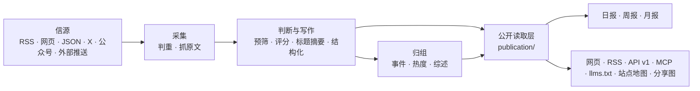
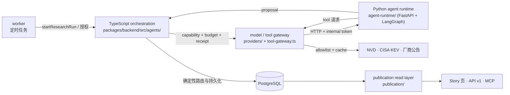

# 架构



## 三个进程

| 进程 | 位置 | 做什么 |
|---|---|---|
| api | `apps/api/` | Fastify。网站自用接口（`/api/site/`）、公开 API（`/api/v1/`）、RSS、MCP、后台接口、图片代理、分享图 |
| worker | `apps/worker/` | pg-boss 任务队列和定时任务：抓信源、调模型、归组、热度、日报、告警、清理 |
| web | `apps/web/` | React Router 服务端渲染的网页。只通过 HTTP 读 api，不碰数据库 |

业务代码都在 `packages/backend/`，前后端共用的类型和常量在 `packages/contracts/`，行业相关的一切在 `industry/`。

## 几条不变的规则

- **一个公开读取层**：网页、RSS、API、MCP、站点地图、分享图读的都是 `packages/backend/src/publication/`，所以各个出口看到的内容一致。新增公开出口也从这里读。
- **页面不调模型**：读者打开页面只读数据库里已经有的结果；模型只在 worker 的任务里调用。
- **花钱的请求有回执**：每个付费请求（模型、X、公众号、Jina）先记一张回执，拿到结果先存再用。进程重启、任务重试时，复用已经付过钱的结果，不重复花钱（`providers/receipts.ts`）。
- **预算熔断**：每个付费服务有每分钟、每小时、每天的上限，超过就暂停（后台“设置 → 预算”）。
- **安全阀**：`COLLECT_ENABLED`、`MODEL_CALLS_ENABLED`、`FEISHU_CONTENT_PUSH_ENABLED`、`FEISHU_INTERNAL_ENABLED`、`INDEXNOW_SUBMIT_ENABLED` 只决定“发不发出去”，不决定走哪套逻辑。开发和测试时关掉。
- **公开内容匿名**：管理员和访客看到的一样；读者的收藏、已读存在浏览器里。后台只允许管理员。
- **旧文不刷屏**：发现时已发布超过 48 小时的资料、新信源的存量、回灌的推送，按原文时间归档，不进“今天”、不推送。
- **来源可追溯**：每条精选都链接原文；站内是否显示全文由信源的 `site_fulltext` 决定，默认只显示摘要。

## 目录

| 位置 | 内容 |
|---|---|
| `industry/` | 行业包：站名文案、分类标签、主题、示范信源、提示词、门槛、品牌、条款页 |
| `packages/backend/src/sources/` | 六种信源的读取器，抓取调度（`collect.ts`） |
| `packages/backend/src/content/` | 资料入库、判重、正文提取和清洗 |
| `packages/backend/src/editorial/` | 判断与写作：`analyze.ts`（流程）、`prompts.ts`（读提示词）、`models.ts`（每一步用哪个模型） |
| `packages/backend/src/events/` | 事件归组、热度、事件综述 |
| `packages/backend/src/publication/` | 公开读取层 |
| `packages/backend/src/reports/` | 日报、周报、月报 |
| `packages/backend/src/providers/` | 模型、向量、X、公众号、Jina 的调用，回执与预算 |
| `packages/backend/src/notify/` | 飞书推送 |
| `packages/backend/src/operations/` | 告警、备份、清理、IndexNow |
| `packages/backend/src/admin/` | 后台接口 |
| `packages/backend/src/leaderboard/`、`monitor/` | 模型榜、Codex 重置监控（见 [模型榜与 Codex 重置监控](leaderboard.md)） |
| `apps/web/app/routes/` | 每个页面一个文件，`routes.ts` 是路由表 |
| `database/migrations/` | 数据库迁移，按编号顺序执行 |
| `scripts/` | 初始化、迁移、种子数据、评测、检查脚本 |
| `tests/` | 后端测试（需要一个名字以 `_test` 或 `_ci` 结尾的空库） |

## 对外出口

| 地址 | 内容 |
|---|---|
| `/` `/all` `/hot` `/topics` `/daily` `/weekly` `/monthly` | 精选、全部动态、热门事件、主题、日报周报月报 |
| `/feed.xml` `/feed/all.xml` `/feed/full.xml` `/feed/daily.xml` | RSS：精选、全部、全文、日报 |
| `/api/v1/` | 公开 API，文档在 `/openapi-v1.json`，说明页在 `/agent` |
| `/api/mcp` | MCP 服务，工具名前缀是 `industry/site.ts` 的 `mcpPrefix` |
| `/llms.txt` `/sitemap.xml` `/robots.txt` | 给大模型和搜索引擎的说明 |
| `/admin` | 后台 |

## 测试

```bash
npm run typecheck
createdb myhot_test
DATABASE_URL=postgres://127.0.0.1:5432/myhot_test node scripts/migrate.ts
DATABASE_URL=postgres://127.0.0.1:5432/myhot_test npm test
npm run build -w @aihot/web && node --test apps/web/tests/*.test.ts
```

测试不访问任何外部服务：模型和付费接口都由本地假服务回答。

---

# SentinelIntel V2 扩展（Phase 3–7）

上面是上游 AIHOT 框架的原始事实，未改动。下面描述在此基础上增量实现的安防持续研判能力。
许可证与署名见 [LICENSE](../LICENSE)、[NOTICE](../NOTICE)；本站不以 AIHOT 作为自有品牌。



## 两个运行时的边界

| 位置 | 运行时 | 职责 |
|---|---|---|
| `packages/backend/src/agents/` | TypeScript | 唯一的写入方：开 run、授权工具调用、记回执、确定性路由、持久化、失败归类 |
| `agent-runtime/` | Python（FastAPI + LangGraph） | 只做语义推理：`research_graph.py`、`tracking_graph.py`、`impact_graph.py`，输出 proposal，不写库 |
| `packages/backend/src/agents/tool-gateway.ts` | TypeScript | 工具能力校验（capability）、allowlist、超时、响应体上限、来源缓存 |
| `packages/backend/src/providers/receipts.ts` | TypeScript | 付费请求回执：先记后付，结果先存再用，`unknown` 走管理员解析 |

**边界规则**：Python 侧没有数据库连接、没有真实密钥、没有直接外网访问；所有付费与外部访问都经
TypeScript 网关，因此预算、回执、allowlist 和审计只有一个实施点。

## 三个 Agent

| Agent | 表 | 迁移 | 输出 |
|---|---|---|---|
| Security Research | `agent_research_runs`、`external_evidence` | `0040`、`0041` | claims / unknowns / conflicts / evidence |
| Event Tracking | `tracking_plans`、`tracking_changes` | `0042`、`0043` | material change、问题状态、下次检查时间 |
| Product Impact | `product_impacts`、`impact_human_reviews` | `0044` | 产品/型号/受影响版本/修复版本/利用状态，或人工复核 |

三个 Agent 共用一个运行表，以 `graph_version` 区分（`phase4-*` / `phase5-*` / `phase6-*`）。读取层
必须按该字段限定自己的 Agent（Phase 7 的一次审计就来自这里：研究面板误读了最新运行的阶段）。

## 安全边界（实现事实）

- **能力（capability）**：每次运行生成一次性 capability，Python 侧只能用它在网关上兑换工具调用。
- **allowlist**：只允许 NVD、CISA KEV 与登记过的厂商公告域名；域名不匹配即失败（v12 的教训）。
- **预算**：按服务分分钟/小时/天上限，超限暂停而不是排队重试。
- **回执**：每个付费请求一张回执；进程重启或任务重试复用已付结果，`unknown` 必须人工解析。
- **超时与体积**：运行级 deadline、单次响应体上限；超时不会产生"部分成功"的写入。
- **缓存来源**：KEV 目录（`0045`）与厂商公告（`0046`）有持久缓存，命中时写入新 Evidence 并标注
  cache provenance，不伪装成实时抓取。
- **不写核心**：三个 Agent 都不修改 Story、Fact、归组或日报；`*_mutations` / `core_mutations`
  检测器每次运行都断言为 0。
- **人工复核**：中等置信度、matcher 不支持的版本表达式、跨来源冲突一律路由
  `impact_human_reviews`，不落 claims 行。

## 公开读取层与 Phase 7 暴露

所有公开出口都经过 `packages/backend/src/publication/`：

- `publication/stories.ts`：Story 详情（`loadStoryDetail` 给网页，`v1Story` 给 API 与 MCP）；
- `publication/agent-intelligence.ts`：**Phase 7 新增的唯一装配点**，`loadStoryAgentIntelligence(storyId)`
  并行读取六个来源并做公开投影（research / tracking / timeline changes / product impact / evidence /
  unknowns），同时给出 `present`、`dataUpdatedAt`、`reviewRequiredCount`；
- 公开投影排除：tool_trace、usage、input_snapshot、capability、trace_id、receipt、prompt_version、
  error_detail、Evidence 的 `normalized` / `provenance` / `content_hash`、tracking 快照、人工复核 payload。

| 出口 | Phase 7 变化 |
|---|---|
| Story 页 | 六个区块（安全研究/追踪状态/时间线变更/产品影响/证据/未知项），按数据存在性独立降级 |
| API v1 | `Story` 加性增加 `agentIntelligence`（`required` 不变） |
| MCP `get_story` | 文本增加"安全研判"摘要，结构化结果加性携带同一 DTO；工具清单不变 |
| Admin | 五个只读视图：Agent 运行、追踪计划、人工复核、产品影响复核、评测结论 |

**读取路径规则**：页面、API、MCP 打开一个 Story 只做 SELECT；不触发模型、不建回执、不创建运行、
不访问外网。Phase 7 的测试对七张表做读取前后计数比较来守住这条规则。

## 刻意没有引入的东西

没有 Kafka、Neo4j、Kubernetes、多 Agent 协作框架、GraphRAG、CrossEncoder 或第二套检索栈。当前设计
的证据是：确定性工作流留在代码里，语义推理只在三个有界 Agent 内发生，付费与外部访问集中在一个网关。
